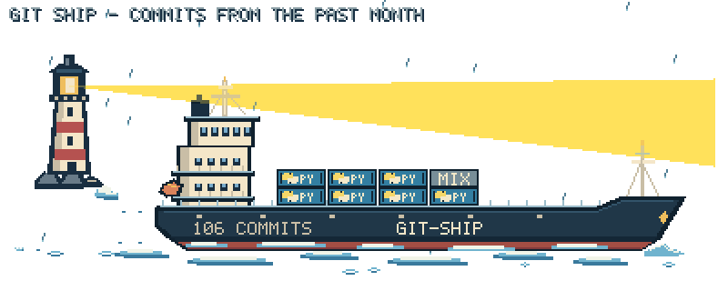
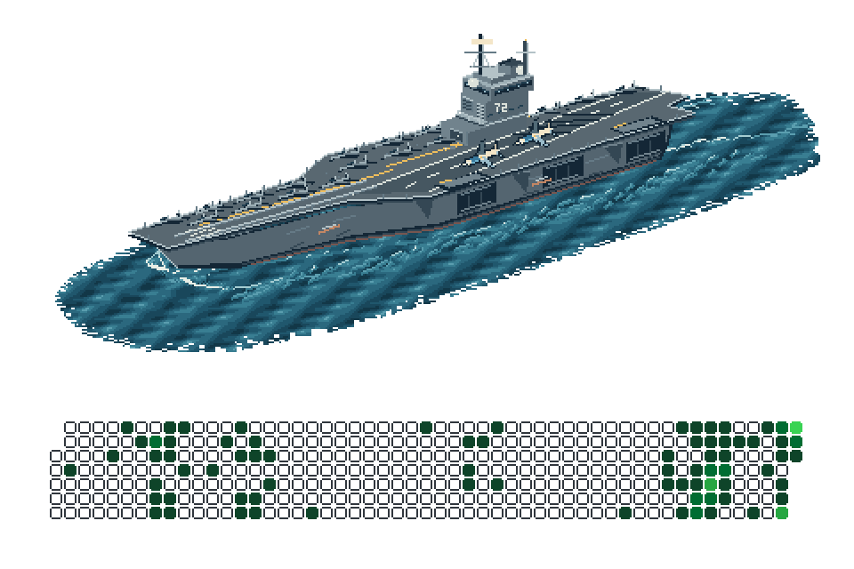

<!--
<picture>
  <source media="(prefers-reduced-motion: no-preference)"
    srcset="https://raw.githubusercontent.com/PingPongPlus/PingPongPlus/output/git-ship.gif?v=247c077-rain">
  
</picture>

Hull counter = all authored punlic commits in the past year · cargo = programming/scripting commits · large container = 6 · small = 1 · MIX = mixed-language leftovers.
-->
<!--
<picture>
  <source media="(prefers-reduced-motion: no-preference)"
    srcset="https://raw.githubusercontent.com/PingPongPlus/PingPongPlus/output/git-jet.gif">
  
</picture>

<a href="https://github.com/PingPongPlus/git-jet">Git Jet</a> · past year · one attack per active day · refreshed daily.
